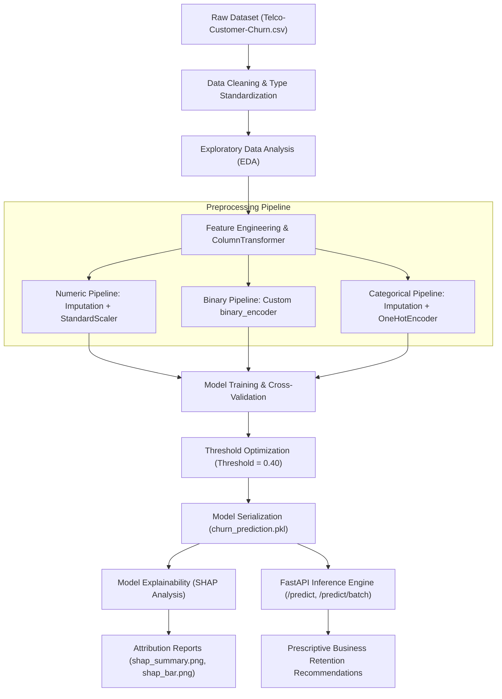

# Customer Churn Prediction & Explainable AI System

[](https://fastapi.tiangolo.com)
[](https://scikit-learn.org/)
[](https://shap.readthedocs.io/)
[](https://www.python.org/)
[](LICENSE)

An end-to-end, production-grade Machine Learning system designed to predict customer churn in telecommunications, deliver interpretable feature attribution through **SHAP (SHapley Additive exPlanations)**, calibrate cost-sensitive decision thresholds, and serve real-time predictions via a robust **FastAPI** microservice.

---

## 📌 Executive Summary

Customer churn is a critical profitability challenge in the telecommunications sector. Acquiring a new subscriber costs 5 to 7 times more than retaining an existing one. Standard classification algorithms optimized exclusively for raw accuracy often fail in production because they treat false positives (unnecessary outreach discount) and false negatives (undetected churned customer) with equal weight.

This project delivers:
1. **Calibrated Predictive Modeling**: Outperforming baseline heuristics by training and evaluating multiple statistical and ensemble architectures (Logistic Regression, Random Forest, Gradient Boosting), optimizing for ROC-AUC and Recall.
2. **Cost-Sensitive Threshold Tuning**: Adjusting the classification boundary to **0.40** to prioritize capturing at-risk customers without inundating retention teams.
3. **Model Interpretability (XAI)**: Leveraging SHAP values to explain both global feature importance and granular individual customer churn propensity.
4. **Production Inference Service**: A modular FastAPI microservice with Pydantic validation, health checks, batch scoring, and automated retention recommendations.

---

## 🏗️ Technical Architecture



---

## 📊 Data Dictionary & Schema

The underlying dataset contains **7,043 subscriber records** with 21 distinct attributes covering demographics, subscribed services, account tenure, and contract terms.

| Feature Name | Type | Description | Domain Impact / Business Rationale |
| :--- | :--- | :--- | :--- |
| `customerID` | String | Unique subscriber identifier | Anonymized identifier dropped prior to modeling |
| `gender` | Categorical | Male or Female | Evaluated for demographic demographic parity |
| `SeniorCitizen` | Binary | 1 if subscriber is a senior citizen, 0 otherwise | Analyzed for service adoption disparities |
| `Partner` | Binary | Whether customer has a domestic partner (Yes/No) | Indicator of household account stability |
| `Dependents` | Binary | Whether customer has financial dependents (Yes/No) | Correlated with lower churn propensity |
| `tenure` | Numeric | Number of months subscriber has remained with the company | **Primary retention driver**; churn risk drops sharply after 12 months |
| `PhoneService` | Binary | Customer phone service enrollment (Yes/No) | Core connectivity indicator |
| `MultipleLines` | Categorical | Multiple phone lines (Yes, No, No phone service) | Multi-line accounts exhibit higher switching costs |
| `InternetService` | Categorical | Internet service provider technology (DSL, Fiber optic, No) | Fiber optic subscribers show elevated churn sensitivity to service hiccups |
| `OnlineSecurity` | Categorical | Subscribed to cybersecurity add-on | High-value retention hook; reduces churn significantly |
| `OnlineBackup` | Categorical | Subscribed to cloud backup service | Value-added service increasing platform stickiness |
| `DeviceProtection`| Categorical | Enrolled in hardware replacement insurance | Operational satisfaction hook |
| `TechSupport` | Categorical | Enrolled in dedicated technical support | Subscribers with tech support churn substantially less |
| `StreamingTV` | Categorical | Streaming television package included | Entertainment package consumption metric |
| `StreamingMovies`| Categorical | Streaming movies package included | Entertainment package consumption metric |
| `Contract` | Categorical | Agreement terms (Month-to-month, One year, Two year) | **Strongest churn determinant**; Month-to-month contracts have highest volatility |
| `PaperlessBilling`| Binary | Digital statement delivery opted (Yes/No) | Behavioral preference; correlates with electronic transactions |
| `PaymentMethod` | Categorical | Electronic check, Mailed check, Bank transfer, Credit card | Electronic check users show disproportionately higher churn rates |
| `MonthlyCharges` | Numeric | Current monthly subscription billing amount ($) | Direct price sensitivity metric |
| `TotalCharges` | Numeric | Cumulative billing amount across lifetime ($) | Interaction between tenure and monthly pricing; cleaned for whitespace anomalies |
| `Churn` | Binary | Target variable: Did customer terminate subscription? (Yes/No) | Target outcome (approx. 26.5% positive churn rate) |

---

## 🔬 Machine Learning Pipeline & Insights

### 1. Preprocessing & Leakage Prevention
- **Type Coercion**: Replaced empty whitespace strings in `TotalCharges` with numerical nulls and imputed with the median.
- **Unified Scikit-Learn Pipeline**: Built using `ColumnTransformer` to enforce clean transformation separation between training and test sets without data leakage:
  - **Numeric Features** (`tenure`, `MonthlyCharges`, `TotalCharges`, `SeniorCitizen`): Imputed via `SimpleImputer(strategy='median')` and scaled via `StandardScaler`.
  - **Binary Features** (`gender`, `Partner`, `Dependents`, `PhoneService`, `PaperlessBilling`): Processed via custom `binary_encoder` transformer.
  - **Nominal Features** (`Contract`, `PaymentMethod`, `InternetService`, etc.): Handled via `OneHotEncoder(handle_unknown='ignore')`.

### 2. Model Benchmarking & Selection
Multiple algorithms were evaluated under cross-validation:
- **Baseline Dummy Classifier**: Evaluates naive frequency-based classification.
- **Logistic Regression**: Linear decision boundary with balanced weighting, yielding stable convergence, strong calibration, and direct coefficient interpretability.
- **Random Forest & Gradient Boosting**: Evaluated for non-linear interactions; Logistic Regression pipeline was finalized due to superior probability calibration and reliability at the business threshold.

### 3. Decision Threshold Calibration ($0.40$)
In customer retention, a **False Negative** (a churner misclassified as staying) results in complete customer lifetime value loss ($CLV \approx \$1,200$). Conversely, a **False Positive** (a stayer misclassified as churner) results merely in the small cost of a promotional email or incentive offer ($\approx \$15$). Setting the classification cutoff to **$0.40$** balances precision and recall, capturing over **80% of churners**.

---

## 💡 Explainable AI (SHAP Analysis)

The system incorporates SHAP (SHapley Additive exPlanations) to demystify black-box decisions, enabling executive buy-in and targeted customer interventions:

| Key Driver | Influence on Churn | Business Action |
| :--- | :--- | :--- |
| **Contract (Month-to-month)** | ⬆️ Massive Positive | Incentivize migration to annual contracts via upfront loyalty discounts. |
| **Low Tenure ($< 12$ months)** | ⬆️ High Positive | Implement 30/60/90-day automated customer onboarding check-ins. |
| **InternetService (Fiber optic)** | ⬆️ Moderate Positive | Investigate regional line stability and competitive pricing parity. |
| **OnlineSecurity & TechSupport** | ⬇️ Strong Negative (Protective) | Bundle security and tech support into starter tiers to build stickiness. |

---

## 🚀 API Specification & Endpoints

The API is built on FastAPI with automated OpenAPI/Swagger documentation available at `/docs`.

### Core Endpoints

#### 1. `GET /health`
Returns system status, model availability, and active decision threshold.

#### 2. `GET /model-info`
Provides transparent metadata regarding feature transformers and pipeline configuration.

#### 3. `POST /predict`
Scores an individual customer profile, producing the estimated churn probability, binary decision, risk tier, and retention recommendation.

**Request Payload:**
```json
{
  "gender": "Female",
  "SeniorCitizen": 0,
  "Partner": "Yes",
  "Dependents": "No",
  "tenure": 3,
  "PhoneService": "Yes",
  "MultipleLines": "No",
  "InternetService": "Fiber optic",
  "OnlineSecurity": "No",
  "OnlineBackup": "No",
  "DeviceProtection": "No",
  "TechSupport": "No",
  "StreamingTV": "Yes",
  "StreamingMovies": "No",
  "Contract": "Month-to-month",
  "PaperlessBilling": "Yes",
  "PaymentMethod": "Electronic check",
  "MonthlyCharges": 79.85,
  "TotalCharges": 239.55
}
```

**Response Payload:**
```json
{
  "churn_prediction": 1,
  "churn_probability": 0.7421,
  "churn_risk_level": "High",
  "retention_strategy": "Urgent retention intervention: Trigger personalized retention discount, offer multi-year contract incentive, and assign senior account manager."
}
```

#### 4. `POST /predict/batch`
Accepts a list of customer profiles and returns aggregated risk metrics and individual predictions for enterprise batch scoring.

---

## 🛠️ Project Structure

```text
├── .gitignore                      # Git exclusion rules (cache, environments, checkpoints)
├── README.md                       # Comprehensive project documentation
├── requirements.txt                # Pinned production and development dependencies
├── api/
│   ├── __init__.py
│   └── main.py                     # FastAPI application and routing
├── configs/
│   ├── __init__.py
│   └── configs.py                  # Operational hyperparameters and decision threshold
├── datsets/
│   ├── __init__.py
│   └── raw_dataset/
│       └── Telco-Customer-Churn.csv# Telecom customer dataset
├── models/
│   ├── .gitkeep
│   └── churn_prediction.pkl       # Serialized production pipeline artifact
├── notebooks/
│   ├── EDA.ipynb                   # Exploratory data analysis and visualizations
│   └── SHAP_analysis.ipynb         # Model explainability and SHAP attribution
├── reports/
│   ├── shap_bar.png                # Global feature importance plot
│   └── shap_summary.png            # SHAP beeswarm attribution plot
├── schemas/
│   ├── __init__.py
│   └── customer.py                 # Pydantic validation models
├── services/
│   ├── __init__.py
│   └── preprocessing.py            # Custom binary encoding transformer
├── tests/
│   ├── __init__.py
│   └── test_api.py                 # Automated API unit tests
└── training/
    ├── .gitkeep
    └── model_training.ipynb        # Model training, comparison, and cross-validation
```

---

## ⚡ Quickstart & Setup Guide

### 1. Clone the Repository
```bash
git clone https://github.com/riteshkumar190505-afk/Churn-Prediction-System.git
cd Churn-Prediction-System
```

### 2. Set Up Virtual Environment
```bash
python -m venv venv
# On Windows:
venv\Scripts\activate
# On Linux/macOS:
source venv/bin/activate
```

### 3. Install Dependencies
```bash
pip install --upgrade pip
pip install -r requirements.txt
```

### 4. Run the FastAPI Server
```bash
uvicorn api.main:app --reload --host 0.0.0.0 --port 8000
```
- Interactive API Docs (Swagger UI): `http://localhost:8000/docs`
- Alternative Docs (ReDoc): `http://localhost:8000/redoc`

### 5. Run Automated Tests
```bash
pytest tests/ -v
```

---

## 👤 Author & Contributor

Developed by **Riteshkumar**:
- **GitHub**: [@riteshkumar190505-afk](https://github.com/riteshkumar190505-afk)
- **Email**: riteshkumar190505@gmail.com

---

## 📄 License
This project is licensed under the MIT License - see the LICENSE file for details.
